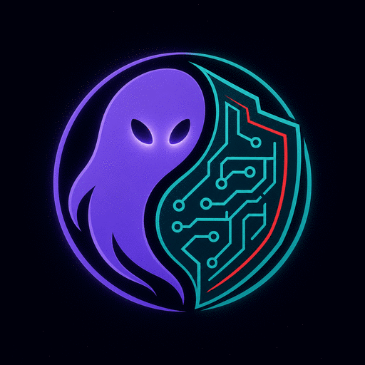

<div align="center">



# Ghost Vanguard

**Security, moderation and support desk for the Midtown Discord network**

Anti-nuke and the threat board · Moderation and audit logging · Ticket desk · Live dashboard · Server recovery

[](https://github.com/aidendixon602-png/Ghost-Vanguard/actions/workflows/ci.yml)


[Overview](#overview) · [Capabilities](#capabilities) · [The threat board](#the-threat-board-defence-and-counter-attack) · [Dashboard](#dashboard) · [Tickets](#ticket-desk) · [Workspace](#workspace) · [Getting started](#getting-started) · [Development](#development)

</div>

> **v3.0.0 — the two bots are one.** The Midtown Desk ticket bot is now part of this codebase, midtown-desk is retired, and the product is called **Ghost Vanguard**. One Node.js process, one database, one set of ranks: **defence and counter-attack, balanced.**

---

## Overview

Ghost Vanguard protects a network of Discord servers from account takeovers, raids and staff abuse, gives staff one consistent toolset for moderation across every server, and runs the support desk those servers depend on. A single bot instance serves every authorized server. Settings, cases, tickets, threat scores and records are stored per server in SQLite, and every action that changes a server is confirmed, logged and attributable to a person.

It is deliberately **balanced — yin and yang**. Defence reacts: anti-nuke strips an attacker and puts back what they broke. Offence answers: the threat board remembers repeat attackers and counter-attacks on its own, only when the score is high or critical, only in enforce mode, and always reversibly. Everything the bot does is visible in Discord and on the dashboard.

**Design principles**

- **Fail safe.** Evidence is recorded before any action, every destructive action asks for confirmation, and permissions are re-checked at the moment of confirmation.
- **Least privilege.** Server ranks, bot-wide ranks and developer access are separate. Discord's Administrator permission never unlocks actions that weaken protection.
- **Reversible by default.** Strips save roles first, bans are recorded with their reason, and layout changes can be restored from snapshots.
- **Accurate logs.** Anything Discord does not confirm is shown as *Unavailable*, never guessed.
- **Balanced.** Defence contains, offence counter-attacks, and both are governed by one readable rule set (`planResponse`) rather than ad-hoc thresholds.

## Capabilities

### Protection
| Feature | Description |
|---|---|
| **Anti-nuke** | 17 rules covering mass bans and kicks, channel/role deletion, dangerous permission grants, bot additions, webhooks and server edits. New or unconfigured servers start in observe mode; enforcement requires a successful readiness check and an explicit confirmation. Everyday rules warn first, staff get a heads-up one step before any limit, and offenders are stripped with the damage reverted. False alarms are undone in one click. |
| **Whitelist** | Per-user or per-role exemptions, either full or per rule, with optional expiry. Includes presets for common staff roles and built-in recognition of verification bots. |
| **Raid response** | Raid mode, server-wide lockdown with exact restore, emergency mode, new-account holds, join-flood detection. |
| **Content protection** | Automod (spam, links, invites, optional AI moderation), scam-link and scam-image detection, staff anti-ping. |
| **Threat board** | Every confirmed incident scores the member behind it. Watch (25+) is staff's chance to step in first, High (55+) strips their access and puts the damage back, Critical (85+) counter-attacks and bans. Whitelisted people, the bot, the server owner and observe mode are never auto-actioned, everything is logged and reversible, and a quiet attacker cools off (scores halve daily, entries expire after a week). See [docs/user/threat-board.md](docs/user/threat-board.md). |

### Moderation
| Feature | Description |
|---|---|
| **Moderation suite** | Ban, tempban, softban, massban, kick, timeout, warnings with automatic escalation, cases, notes and appeals. Reasons are optional. |
| **Ban records** | One record per ban (`BAN-0001`) in `#bans` with reason, evidence, moderator, duration and expiry, including bans made by hand or by other bots. |
| **Network bans** | Developer-issued genrebans and hardbans across every server, enforced on join. Server staff cannot lift them: genrebans are lifted by a Supreme Leader or Developer (or excepted for one server by an Overseer+), hardbans only by a Developer. |
| **Role management** | `/role` with full hierarchy checks, per-role giving rules, and one-click role restore for members who leave and rejoin. |

### Support desk
| Feature | Description |
|---|---|
| **Ticket desk** | Panel-driven tickets with per-type categories, claim/close/rename, a 60-second cooldown and a per-member open limit. Closing posts a full transcript, waits five seconds, then removes the channel. |
| **Satisfaction** | Every close DMs the requester a rating; the averages feed the weekly staff report and the dashboard. |
| **Upkeep** | Automatic closing of idle tickets, staff reminders, and a weekly report of volume, response and ratings. |

### Operations
| Feature | Description |
|---|---|
| **Control panel** | A private `#vanguard-control` channel with buttons to restore or strip roles, revert the bot's actions and review recent activity. Restricted to authorized staff, confirmed and logged. |
| **Audit logging** | `#ghost-vanguard-logging`: message edits and deletions, role, channel, member and permission changes, each with the verified actor. |
| **Recovery** | Snapshots and scheduled backups of roles, channels and permissions, with previewed, rate-limit-aware restores. |
| **Dashboard** | A self-contained read-only page (no build step, no external assets) showing servers, protection, the threat board, the ticket desk and recent incidents. Served by the bot next to `/healthz`, or standalone against the same database. See [docs/user/dashboard.md](docs/user/dashboard.md). |
| **Self-hosting tools** | Supervised launcher, automatic CI-gated updates with rollback, hourly verified database backups, health endpoint. |

## Access model

Every command has a minimum rank, and each rank includes everything below it. Bot-wide ranks work in every server; server ranks work only where they were given.

| Rank | Scope | Can do |
|---|---|---|
| **Developer** | All servers | The bot owner (`BOT_OWNER_ID`) and `DEVELOPER_IDS`. Developer operations include diagnostics, updates, database and server controls, global ranks and network bans; comma commands require an exact `DEVELOPER_IDS` entry, even for the bot owner |
| **Server Owner** | Own server | Whoever owns the Discord server. Outranks Supreme Leaders there: Head Admin, plus security admins, undoing setting changes and undoing strips. Never gets bot-wide tools |
| **Supreme Leader** | All servers | Everything below; can lift genrebans from ban-log controls. Developer comma commands remain restricted to exact `DEVELOPER_IDS` entries |
| **Overseer** | All servers | Bot Manager, plus one-server genreban exceptions through `/mod unban` |
| **Bot Manager** | All servers | Head Admin-level access in every server; this rank does not unlock comma commands |
| **Head Admin** | One server | Anti-nuke, whitelist, control panel, backups, staff ranks |
| **Admin** | One server | Lifting ordinary bans, accepting appeals, raid tools, automod, scam protection, logging |
| **Moderator** | One server | Bans, kicks, tempbans, purges, ban records, denying appeals |
| **Helper** | One server | Warnings, short timeouts, cases and notes |

**Developer is the top bot-wide rank:** the bot owner (`BOT_OWNER_ID`) and IDs in `DEVELOPER_IDS`. Developer-only actions are hidden from the slash menu and handled as comma-prefix commands. Every comma command requires the exact user ID in `DEVELOPER_IDS`—`BOT_OWNER_ID` alone is not enough, so add the owner's ID there too. Use `/help` for available slash commands and `,help` for the Developer command list. Comma commands and the bot's replies are deleted after 60 seconds so they don't linger in public channels; set `COMMA_DELETE_SECONDS` (`0` keeps them). Sensitive and admin slash replies are private (ephemeral); ordinary public utility replies stay public.

**Who can lift a ban**

| Ban | Lifted by |
|---|---|
| Ordinary server ban | Admin rank, Discord Administrator or the server owner (`/mod unban`, ban-log buttons, accepting an appeal) |
| Genreban | A Supreme Leader or Developer can lift it everywhere from ban-log controls; an Overseer or higher can let the person back into one server (`/mod unban`). The comma command `,ungenreban` requires an exact `DEVELOPER_IDS` entry |
| Hardban | Developer only; `,unhardban` requires an exact `DEVELOPER_IDS` entry |

Anti-nuke watches **everyone**. Developers, server owners and whitelisted people are alerted on (security log, global feed and DM) but never punished; everyone else, Supreme Leaders included, is. The complete list of commands for each rank is in **[docs/ranks.md](docs/ranks.md)**.

## The threat board: defence and counter-attack

Anti-nuke answers an incident immediately; the threat board is the memory that decides whether the person behind it is a one-off mistake or a repeat attacker. It is the only part of the bot that counter-attacks, and it does so on a rule that is short enough to read:

| Level | From | What the bot does by itself |
|---|---|---|
| 🟢 Quiet | 0 | Nothing — shown on the board only |
| 🟡 Watch | 25 | Nothing — staff's chance to step in first |
| 🟠 High | 55 | Defence: strip their dangerous roles, put their damage back |
| 🔴 Critical | 85 | Counter-attack: strip, restore, then ban |

Never automatic: whitelisted people, the bot itself, the server owner, servers with protection off or unauthorized, observe mode, and anything inside a ten-minute cooldown. A quiet attacker cools off — scores halve once a day and entries expire a week after the last incident.

`/antinuke threats list` shows the board, `view` shows one member's full history, and `clear`, `release` and `strike` (Head Admin and above) are how staff undo or force an action. Every automatic action is in the server's log channel too, and **all of them are reversible**. Full detail: [docs/user/threat-board.md](docs/user/threat-board.md).

## Dashboard

```bash
npm run dashboard        # against the bot's database, no Discord needed
npm run dashboard:demo   # seeded sample data to look at
```

One self-contained page: no build step, no external fonts, scripts or images, so it works on a host with no internet. It shows the overview, the live threat board, the ticket desk and recent incidents, and re-reads the API every 15 seconds. The bot serves the same thing on its health port, so in production there is nothing extra to run. Set `DASHBOARD_TOKEN` to require a token (the bot prints whether it is required at startup). Full detail: [docs/dashboard.md](docs/dashboard.md).

## Ticket desk

A staff member posts the panel once with `/ticket setup`; members press a button and get a private channel for their ticket type. Closing posts a transcript, waits five seconds, then deletes the channel, and the requester is DMed a rating. Idle tickets close themselves, and staff get a weekly report. The desk numbers (open, unclaimed, urgent, average rating) are on the dashboard.

## Commands

Commands are grouped by job, one top-level command each. Every command in Discord's `/` menu says what it does and who can use it (for example *Ban a user · Moderator+*).

| Command | Purpose |
|---|---|
| `/antinuke` | Status, on/off, checks, safety scan, settings, whitelist, incidents, quarantine, threat board |
| `/automod` | Spam, invites, links, AI moderation, alts, quiet hours, scam links, staff-ping protection |
| `/raid` | Lockdown and unlock, raid mode, emergency mode, new accounts, webhooks, health check |
| `/mod` | Ban, kick, timeout, warn, purge, slowmode, ban records, cases, notes, warnings, appeals, nicknames |
| `/role` | Give, remove and restore roles; who can give which role |
| `/setup` | Control panel, security settings and admins, logging, staff ranks, welcome, config, permissions, history |
| `/ticket` | Ticket panel, types, setup, claim, close, transcripts, block list |
| `/recovery` | Snapshots, backups, layout copy |
| `/info` | Users, roles, server, bot, latency |
| `/roblox` | Verification, lookups, blacklist, group binds |
| `/dev`, `/network`, `/restart` | Bot staff: diagnostics, updates, alerts, servers, database, network bans |
| `,` commands | Developer operations: restart, updates, diagnostics, database, server authorization, global ranks and network bans. Every comma command requires an exact `DEVELOPER_IDS` entry, including for the bot owner |

`/help` in Discord lists only the slash commands available to you; `,help` lists Developer comma commands for authorized IDs. Sensitive/admin slash replies are ephemeral; ordinary public utility replies stay public. The full reference is in **[docs/commands.md](docs/commands.md)**.

## Workspace

Ghost Vanguard now includes a reusable, guild-scoped **Workspace** system for submissions, reviews, records, tasks, staff synchronization and reports. It is button-first: members and staff use persistent panels, while `/setup config workspace-*` is reserved for setup, publishing, status, enable/disable and synchronization. The system does not replace the existing ticket desk.

Start with [docs/user/workspace.md](docs/user/workspace.md). Configure Google Sheets authentication, run `/setup config workspace-setup` with real channel and role selectors, validate the workbook, then run `/setup config workspace-publish`. The Midtown Archives preset is limited to guild `1556485316838293587` and is not active until the existing authorization process and live workbook validation succeed. No channel IDs or staff IDs are guessed.

## Getting started

### Requirements

- Node.js 24
- A Discord application with a bot token and the **Server Members** and **Message Content** intents enabled
- Persistent storage for the `data/` directory

### Configuration

Copy [`.env.example`](.env.example) to `.env` and set at least:

| Variable | Required | Description |
|---|---|---|
| `DISCORD_TOKEN` | Yes | Bot token from the Discord Developer Portal |
| `DISCORD_CLIENT_ID` | Yes | Application ID |
| `DEVELOPER_IDS` | Yes | Comma-separated Discord user IDs with Developer access. Required for every comma command, including when the user is `BOT_OWNER_ID` |
| `DATABASE_PATH` | No | SQLite database location (default `./data/vanguard.db`) |
| `DASHBOARD_ENABLED` | No | Set to `false` to disable the built-in dashboard while keeping `/healthz` available (default: enabled) |
| `DASHBOARD_TOKEN` | Recommended | Require a token for the dashboard and its API when enabled. Without it the dashboard is open to anyone who can reach the port, so keep it on localhost |
| `BOT_OWNER_ID` | Recommended | The bot owner: Developer rank for ordinary permission checks, and the default for `TRUSTED_DM_IDS`. Add this ID to `DEVELOPER_IDS` separately to use comma commands |
| `SUPREME_LEADER_IDS` | No | Supreme Leaders: bot-wide rank below Developer; may lift genrebans from ban-log controls, but do not get comma commands. Nobody is built in; every start prints who has bot-wide access |
| `COMMA_DELETE_SECONDS` | No | How long comma commands and their replies stay before being deleted (default `60`; `0` keeps them) |
| `ANTINUKE_LOCK` | Recommended | `true`: only Developers can turn anti-nuke off or weaken it; servers switched off come back on at start |
| `PROTECTED_USERS` | No | People staff can never ban, kick, time out or de-role; manual attempts are undone and alerted |
| `PROTECTED_ROLES`, `PROTECTED_ROLE_ASSIGNERS` | No | Roles only the listed people (and Developers) may give; anyone else's grant is taken back |
| `COMMAND_BLACKLIST` | No | People blocked from specific commands, e.g. `111…:mod ban\|network;222…:*` |
| `GLOBAL_ALERT_CHANNEL_ID` | No | One channel that receives every anti-nuke trigger from every server |
| `TRUSTED_DM_IDS` | No | Who gets the daily database backup and other bot DMs (default: `BOT_OWNER_ID`). Security alerts also go to every Developer |
| `UPDATE_REPO`, `UPDATE_TOKEN` | No | Enable automatic updates (see below) |
| `ROVER_API_KEY`, `BLOXLINK_API_KEY` | No | Roblox verification providers |
| `AI_ENABLED`, `OPENAI_API_KEY` | No | AI moderation and `/ask` |

### Running

```bash
node launch.js
```

`launch.js` installs dependencies when needed, starts the bot, restarts it if it stops, and restores the database from its most recent backup if the file is missing. On hosting panels such as Wispbyte, use `cd /home/container && node launch.js` as the start command.

### Adding a server

1. Invite the bot using the link printed at startup. Inviting with a developer account authorizes the server automatically.
2. Run `/setup logs setup` to create the ban and server log channels (including the security log used by anti-nuke).
3. Move the Ghost Vanguard role above staff roles where possible. `/antinuke check` reports missing permissions and roles the bot cannot contain.
4. When the readiness check passes, run `/antinuke enable` and review the confirmation to start enforce mode. New or unconfigured servers stay in observe mode until this is done.
5. Run `/setup panel` to create the staff control panel.
6. Link staff roles to ranks with `/setup staff role`.
7. Run `/ticket setup` to post the ticket panel.

## Operations

### Automatic updates

With `UPDATE_REPO` and `UPDATE_TOKEN` set (a fine-grained token with read-only *Contents* and *Actions* on this repository), the launcher checks `main` every five minutes:

```
push to main → CI (typecheck, build, tests, secret scan) → launcher installs → bot restarts
```

- Only commits that passed CI are installed.
- A version that stops within two minutes of installing is rolled back automatically and skipped.
- `.env` and `data/` are never modified.
- Developers check update status or install now with `,update status` or `,update now`; restart from a server with `,restart`. These comma commands require an exact `DEVELOPER_IDS` entry (including for the bot owner). Prefix commands require Message Content Intent enabled in the Discord Developer Portal, and `MESSAGE_CONTENT_ENABLED` must not be set to `false`.

### Backups

- **Database:** verified backups every hour, kept on a rolling schedule in `data/database-backups`, plus a daily compressed copy sent by DM only to `TRUSTED_DM_IDS` (default: the bot owner). Lost settings can be merged back from any backup with `,database restore-settings` (exact `DEVELOPER_IDS` membership required).
- **Server layout:** snapshots and scheduled backups with `/recovery`.

### Running more than one copy

Run only one instance per bot token. A database lease prevents a second instance from sharing the same database, but two hosts using the same token would both respond to events.

## Development

```bash
npm ci
npm run build    # compile src/ to dist/ (dist/ is committed and verified by CI)
npm test         # full test suite
npm run dev      # run from source
```

| Script | Purpose |
|---|---|
| `npm run check` | Type-check without emitting |
| `npm run docs` | Regenerate `docs/commands.md` and `docs/ranks.md` from the command definitions |
| `npm run doctor` | Validate configuration and command loading |
| `npm run database:restore` | Restore a verified database backup (bot stopped) |
| `npm run dashboard` | Serve the dashboard against the database, without starting Discord |
| `npm run dashboard:demo` | The same, with seeded sample data |

Every pull request and push runs the CI workflow: type-check, build, a check that `dist/` matches `src/`, the full test suite, and a scan that blocks committed secrets or databases. The command and rank documentation is generated from code and verified by a test, so it cannot drift.

<details>
<summary><b>Project structure</b></summary>

```
src/
  index.ts         entry, health endpoint & wiring (see src/bot/lifecycle.ts)
  config.ts        env parsing & validation — single source for all settings
  branding.ts      product name & default channel names (Ghost Vanguard)
  console-ui.ts    startup panel rendering
  errors.ts        AppError, redact(), logEvent()
  core.ts          helpers: clip, dangerous(), RULES, KeyedQueue
  logging.ts       LogQueue — per-guild outbox with backoff
  bot/             registry, command-tree, interactions, guard, ranks, prefix-commands
  commands/        68 slash commands in 8 groups → grouped tree in bot/command-tree.ts
  security/        anti-nuke engine, threat-board, scam, lockdown, readiness
  audit/           ban-log, event-log, log-setup, downtime, redaction
  database/        Store (node:sqlite), migrations, backups
  recovery/        snapshots, recovery engine, limits & cleanup
  features/        tickets, automod, joins, rejoin-roles, schedules
  integrations/    roblox.ts + http.ts (4-worker cache, circuit breaker)
  dashboard/       no-build HTML + JSON API (served beside /healthz)
  workspace/       submissions, reviews, records, tasks, staff, Sheets sync
  ui/              embeds, panels, command-docs generator
launch.js          supervisor: install/deps, DB restore, run + auto-update (CI-gated)
scripts/
  build/           clean.mjs, verify-install.mjs, update-preflight.mjs
  ops/             restore-database.mjs, scam-setup.mjs, dashboard-demo.mjs
  docs/            generate.ts → docs/commands.md + docs/ranks.md
test/              node:test suites (Node 24, node:sqlite)
docs/
  commands.md, ranks.md, changelog.md           generated / release history
  user/            architecture.md, threat-board.md, dashboard.md, … (operator guides)
  internal/notes/  command-audit.md, owner-trust-fix.md … (historical)
dist/              compiled output — committed for Wispbyte hosts
```

</details>

## Documentation

| Document | Contents |
|---|---|
| [commands.md](docs/commands.md) | Every command and its required rank |
| [ranks.md](docs/ranks.md) | Every rank and the commands it unlocks |
| [security-controls.md](docs/user/security-controls.md) | How anti-nuke decides, warns, strips and reverts |
| [threat-board.md](docs/user/threat-board.md) | Scoring, levels, the counter-attack and how to reverse it |
| [dashboard.md](docs/user/dashboard.md) | Running, securing and reading the dashboard |
| [antinuke-locked.md](docs/user/antinuke-locked.md) | The 17 rules and their limits |
| [recovery.md](docs/user/recovery.md) | Snapshots, backups and restores |
| [server-lifecycle.md](docs/user/server-lifecycle.md) | Invites, authorization and removal |
| [hosting.md](docs/user/hosting.md) | Hosting, persistence and the health endpoint |
| [architecture.md](docs/user/architecture.md) | How the code is organized |
| [workspace.md](docs/user/workspace.md) | Sheets-backed submissions, reviews & staff sync |
| [changelog.md](docs/changelog.md) | Release history |

## Security

Do not commit `.env`, tokens, API keys or anything under `data/`; CI rejects commits that contain them. If a token is exposed, reset it in the Discord Developer Portal immediately and update the host's `.env`. To report a vulnerability, see [SECURITY.md](SECURITY.md).

## License

This repository is publicly viewable, but no open-source license is granted. All rights reserved. Public visibility does not grant permission to reuse, redistribute, or modify the code without prior written permission.
